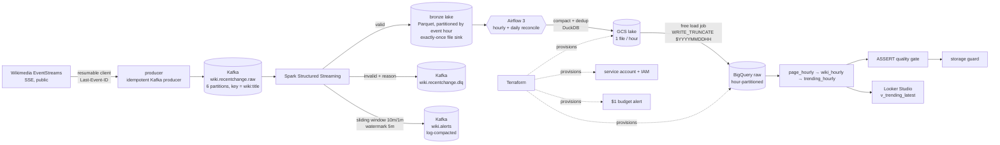

# WikiPulse — what is the world editing right now?

A real-time + batch data platform over **every edit made to Wikipedia**, built on the
production stack: **Kafka → Spark Structured Streaming → GCS lake → BigQuery**, orchestrated
by **Airflow 3**, cloud infrastructure in **Terraform**, running at **$0/month**.

Wikimedia publishes every change to every wiki as a public Server-Sent-Events stream
(tens of events per second, 24/7). WikiPulse turns it into:

* **Real-time "edit storm" alerts** (latency ≈ 1 min) — many distinct humans hammering one
  article in a 10-minute window: the fingerprint of breaking news, a death, or an edit war.
* **An hourly warehouse** with per-page and per-wiki metrics, plus a **trending model** that
  scores each article's edit volume against its own 7-day baseline.
* **Data-quality gates, idempotent reloads, late-data reconciliation and free-tier cost guards**,
  which are the parts that separate a production pipeline from a tutorial.



---

## Is it really free? Yes, with two honest caveats

| Piece | Where it runs | Why it costs $0 |
|---|---|---|
| Kafka, producer, Spark, Airflow | Docker Compose on your machine (~4 GB RAM) | Your hardware |
| GCS lake | `us-central1` bucket | Always Free: 5 GB-months regional storage (US regions), 5K Class A ops/month |
| BigQuery | `us-central1` datasets | Always Free: 10 GiB storage + 1 TiB queries/month; **batch load jobs are free** |
| Terraform state | local (or a GCS backend) | — |
| Dashboard | Looker Studio on `v_trending_latest` | Free |

**Caveat 1: you must enable billing (add a card).** The no-card BigQuery *sandbox* doesn't
allow DML (`DELETE`/`INSERT`) and expires tables after 60 days, and the pipeline's idempotent
models need DML. Enabling billing does **not** mean paying. The free tier still applies, and
Terraform can create a **$1 budget alert** (`billing_account_id`) so you hear about any spend
straight away.

**Caveat 2: compute runs on your machine, not in the cloud.** A managed always-on
Kafka + Spark + Airflow (Confluent Cloud, Dataproc, Composer) costs real money every hour,
and GCP's free `e2-micro` VM (1 GB RAM) can't hold this stack. That's the one place where
money buys you something. For a project, local compute plus a real cloud warehouse is what
the industry does in dev anyway. Free 24/7 option: Oracle Cloud's Always Free ARM VM
(4 vCPU / 24 GB) runs this exact `docker-compose.yml` unchanged.

### How the design keeps you inside the free tier

These numbers are estimates for the default 8-wiki allowlist. The storage guard enforces the limits regardless.

* **GCS operations, not storage, are the trap.** A streaming job writing straight to GCS
  every minute creates tens of thousands of objects a month, well past the 5,000 free Class A
  ops. So Spark writes to a local bronze lake, and Airflow uploads **one compacted file per
  hour** (~750 writes/month).
* **Bucket soft-delete is disabled.** By default it would keep, and bill, deleted objects for 7 days.
  A lifecycle rule deletes objects after 10 days.
* **Raw BigQuery partitions expire after 14 days** (`raw_partition_expiration_days`). Aggregates are
  kept for 90 days (`page_hourly` grows ~20 MB/day, so a year would approach the limit).
* **`require_partition_filter = true`** on the raw table means a forgotten `WHERE` can't scan everything.
* **Every query reads one hour.** BigQuery bills at least 10 MB per table referenced, so the
  ~6 queries/hour cost about 100–150 MB, roughly 100 GB/month or ~10% of the free TiB.
* **`storage_guard`** sums `INFORMATION_SCHEMA.PARTITIONS` for both datasets after every run and fails
  the DAG at 8 GiB, well before 10 GiB.
* `WIKI_ALLOWLIST` leaves out Wikidata and Commons, which are mostly bot traffic and the bulk of
  global volume.

---

## Quickstart

### 1. Offline demo (no cloud, 2 minutes)
```bash
make up        # Kafka + synthetic producer (with injected edit storms) + Spark + Airflow
make alerts    # watch storm alerts arrive (~1–2 min after start)
make dlq       # see malformed records dead-lettered with a reason
make ui        # optional: Kafka UI on http://localhost:8081
```
Spark UI: http://localhost:4040 (Structured Streaming tab: input rate, batch duration, state).

### 2. Cloud warehouse
```bash
cp terraform/terraform.tfvars.example terraform/terraform.tfvars   # set project_id (+ billing_account_id)
gcloud auth application-default login
make infra     # GCS bucket, BigQuery datasets/tables/view, service account, IAM, budget
make sa-key    # writes ~/.wikipulse/sa.json: outside the repo, never in git or a synced folder
make env       # copies bucket/project/location from terraform outputs into .env
```

### 3. Go live
```bash
# in .env: WIKIPULSE_CONTACT=<your email or repo URL>   (Wikimedia User-Agent policy)
make up-live
```
Airflow (http://localhost:8080) runs `wikipulse_hourly` every hour. Then:
```sql
SELECT rank, wiki, title, human_edits, human_editors, spike_score, url
FROM `<project>.wikipulse_analytics.v_trending_latest`
ORDER BY rank LIMIT 25;
```
To backfill or re-run anything: `make trigger HOUR=2026-11-12T05` or `make reconcile DAY=2026-11-11`.

---

## Design decisions (the interview talking points)

**Delivery semantics, end to end.**
The producer is idempotent (`enable.idempotence`, `acks=all`), so broker retries never duplicate.
Upstream reconnects *can* replay, because the client resumes from the last persisted SSE
`Last-Event-ID`. Spark's file sink is exactly-once with respect to Kafka offsets (via checkpoint +
`_spark_metadata`). Compaction de-duplicates on Wikimedia's globally unique `meta.id`. The
result is **effectively-once in the warehouse**, and `hour_quality` asserts it (`dupes = 0`).

**Never glob a Spark sink directory.** Failed micro-batches leave orphan files behind. The
batch layer reads **only files committed in `_spark_metadata`**, handling `.compact` snapshots
and deletes. The tests build a real streaming sink, plant an orphan file and prove it's ignored.

**Idempotency everywhere.** Raw loads replace exactly one hourly partition
(`recentchange$YYYYMMDDHH` + `WRITE_TRUNCATE`). Models are `DELETE`+`INSERT` for one hour
inside a transaction. Re-running any hour any number of times converges to the same state,
and that is what makes backfills and late-data fixes boring.

**When is an hour "done"?** In a stream, never fully. The hourly sensor waits until the
stream has committed data for a *later* hour plus a 10-minute grace period (`mode="reschedule"`,
so it holds no worker slot). Anything later still is caught by `wikipulse_reconcile`,
which re-compacts yesterday, compares row counts with `INFORMATION_SCHEMA.PARTITIONS`, and
reloads only the hours that changed.

**One owner per rule.** The producer forwards everything except canaries and filtered wikis.
The Spark job owns the schema contract and gives every bad record exactly one `dq_reason`
(`unparseable_json`, `missing_event_id`, `unknown_type`, `timestamp_out_of_range`, and so on) with
full Kafka provenance in the DLQ, so records can be replayed. A test asserts
`valid + dlq == input`: nothing is silently dropped.

**Stream vs batch split.** Alerts need seconds and tolerate approximation, so the stream uses
`approx_count_distinct`, update mode and a compacted topic that keeps the latest state per page.
Trending needs history and exactness, so it's a batch model over a 168-hour baseline that counts
hours without edits as real zeros.

**Contracts are tested, not hoped for.**
* Synthetic producer output → Spark parser: no unexpected DQ failures.
* Compacted Parquet schema → Terraform's BigQuery JSON schema: names and types match, and
  timestamps are UTC-adjusted so BigQuery loads them as `TIMESTAMP`, not `DATETIME`.
* SQL `INSERT` column lists → Terraform table schemas.

**Data-quality gate** (`hour_quality.sql`, BigQuery `ASSERT`): completeness, uniqueness,
validity, and cross-layer reconciliation (raw article edits = `page_hourly` sum, raw rows =
`wiki_hourly` sum). It runs with `retries=0`, because retrying doesn't fix bad data.

**Least privilege.** The Airflow service account gets `bigquery.jobUser` and
`metadataViewer` on the project, `dataEditor` on its two datasets only, and `objectAdmin` on
its bucket only. There's no SA key in Terraform state.

---

## Data model

| Table | Grain | Notes |
|---|---|---|
| `wikipulse_raw.recentchange` | event | hour-partitioned on `event_ts`, clustered `wiki, change_type, namespace`, 14-day expiry, lineage columns (`kafka_partition/offset/ts`, `ingest_ts`) |
| `wikipulse_analytics.page_hourly` | hour × wiki × article | human vs bot edits, distinct editors, reverts, net bytes |
| `wikipulse_analytics.wiki_hourly` | hour × wiki | bot share, revert rate, unregistered editors, **p50/p95 event→Kafka latency** |
| `wikipulse_analytics.trending_hourly` | hour × rank | top 100: `(x − μ₁₆₈) / √(σ²₁₆₈ + 1)`, needs ≥ 3 human editors |
| `wikipulse_analytics.v_trending_latest` | view | latest hour with clickable article URLs, ready for Looker Studio |

Kafka topics: `wiki.recentchange.raw` (48 h), `wiki.recentchange.dlq` (7 d),
`wiki.alerts` (compacted, key `wiki:title`).

---

## Repository layout
```
producer/         SSE client + Kafka producer (live or synthetic), Dockerfile
streaming/jobs/   transforms.py (pure, tested) + stream_job.py (3 streaming queries)
airflow/dags/     wikipulse_hourly, wikipulse_reconcile (thin TaskFlow wrappers)
airflow/include/  wikipulse/pipeline.py (all batch logic, Airflow-free) + sql/
terraform/        GCS, BigQuery, IAM, budget; schemas/recentchange.json
tests/            44 tests: SSE, routing, Spark transforms, real streaming sink,
                  compaction, contracts, DAG integrity, Terraform structure
.github/workflows CI: pytest + ruff, DAG import on Airflow 3.1.8, terraform validate, compose config
```

`make test` needs Python 3.11+ and Java 17+ (`pip install -r requirements-dev.txt`).
The DAG tests need Airflow installed (see CI).

---

## Swaps and extensions
* **Flink instead of Spark:** replace `streaming/` with a PyFlink job. The Kafka topics and lake layout are the interface.
* **Snowflake instead of BigQuery:** Snowflake has no permanent free tier (30-day trial), so it's
  the paid option. The swap is `load_job_config` → `COPY INTO` and the SQL dialect.
* **dbt:** the `sql/` models map one-to-one to incremental dbt models with `insert_overwrite` on `hour_ts`.
* **Alert fan-out:** a small consumer on `wiki.alerts` → Discord/Slack webhook.
* **Observability:** expose `StreamingQueryListener` metrics to Prometheus/Grafana (both free, both in Compose).
